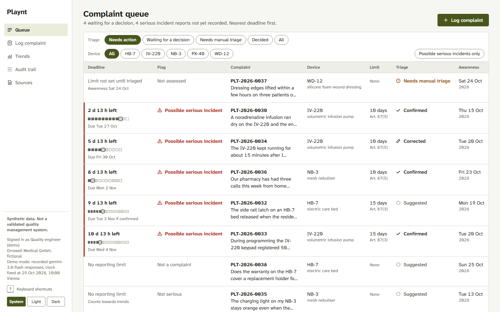
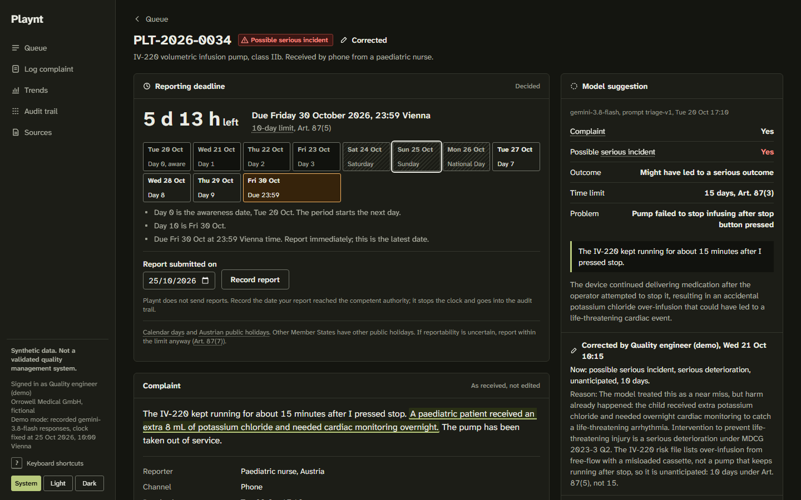

# Playnt

Post-market complaint triage for a fictional medical device manufacturer under the EU Medical Device Regulation. A complaint comes in, a language model suggests whether it is a possible serious incident and which reporting limit applies, and a quality engineer confirms or corrects that suggestion. Every step goes into a hash-linked audit trail, and the deadline clock follows the MDR time limits to the day.

**Live demo: [playnt.vercel.app](https://playnt.vercel.app)**, in demo mode with recorded model responses and the clock fixed at 25 October 2026. Anything you log, confirm or correct there is reset every night.

**Synthetic data. Not a validated quality management system.** The manufacturer (Orrowell Medical GmbH), its five devices and every complaint are invented. Nothing here is fit for real vigilance work.


The GIF shows a real model miss. Gemini flagged a nuisance occlusion alarm as "might have led to a serious outcome, 15 days". The quality engineer corrects it to "complaint, not a possible serious incident" and has to give a reason before the correction is saved.

## What it does

- **Queue, nearest deadline first.** The default view is "Needs action": complaints waiting for a triage decision, plus possible serious incidents whose report has not been recorded yet. A red left rule marks possible serious incidents; the flag is text with an icon, never colour alone.
- **Complaint screen.** Shows the complaint as received, with the model's evidence highlighted in the text, the suggestion with its rationale, and the deadline as a day-by-day calendar with weekends and Austrian public holidays hatched.
- **Confirm or correct.** `C` confirms, `R` opens the correction form. A correction needs a reason of at least 10 characters. The screen updates in place and focus moves to the next complaint waiting for a decision.
- **Keyboard flow.** `J`/`K` or the arrow keys move through the queue, `Enter` opens, `Esc` closes a tooltip or form and then goes back, `?` lists the shortcuts.
- **Regulatory terms explained in place.** Each term (serious incident, 10-day limit, awareness date and others) opens a tooltip on hover, focus or tap with the definition and its source.
- **Trends.** Complaints per device and month from decided triage only, and the problems behind them. Counts only: see [What is simplified](#what-is-simplified).
- **Audit trail.** Append-only, each event linked to the previous one by SHA-256 hash. One button on the audit page re-checks the whole chain and names any broken link.

| Queue | Complaint screen |
| --- | --- |
|  |  |

More screens: [queue, dark](docs/screenshots/queue-desktop-dark.png), [corrected complaint, light](docs/screenshots/detail-corrected-desktop-light.png), [correction form](docs/screenshots/detail-correct-form-laptop-light.png), [intake](docs/screenshots/intake-laptop-dark.png), [trends](docs/screenshots/trends-desktop-light.png), [keyboard shortcuts](docs/screenshots/shortcuts-desktop-dark.png).

## Evaluation

The model was run once over a frozen, labelled set of 40 synthetic complaints. The prompt was not changed after seeing the results.

- Model: `gemini-3.8-flash`, temperature 0, prompt `triage-v1`
- Run on 25 October 2026. The full output, per item, is in [`eval/results/eval-gemini-3.8-flash-triage-v1-2026-10-25.json`](eval/results/eval-gemini-3.8-flash-triage-v1-2026-10-25.json).
- The set was frozen before any model run; [`eval/FROZEN.md`](eval/FROZEN.md) holds the SHA-256 of the labels and the device file, and the evaluation script refuses to run if either changed.

| | All 40 | 28 clear | 12 ambiguous |
| --- | --- | --- | --- |
| Serious incident flag, precision | 0.913 (21 of 23) | 0.933 (14 of 15) | 0.875 (7 of 8) |
| 95% Wilson interval | 0.732 to 0.976 | 0.702 to 0.988 | 0.529 to 0.978 |
| Serious incident flag, recall | 1.000 (21 of 21) | 1.000 (14 of 14) | 1.000 (7 of 7) |
| 95% Wilson interval | 0.845 to 1.000 | 0.785 to 1.000 | 0.646 to 1.000 |
| Time limit agreement, where both flagged | 21 of 21 | 14 of 14 | 7 of 7 |
| Complaint or not, agreement | 40 of 40 | 28 of 28 | 12 of 12 |
| Invalid model output | 0 | 0 | 0 |

The model missed no labelled serious incident and gave the labelled limit (2, 10 or 15 days) every time it flagged one, including both 2-day public health threats. Both errors are over-flagging in the same direction. In EV-28 a home nebuliser that did not switch on before use, for occasional saline, was flagged "might have led" on the reasoning "if a patient relied on it". In EV-30 an oximeter with visibly jumping readings was flagged the same way. The labels call neither serious; for EV-30 the label notes that a reasonable reviewer could flag it.

The demo complaints are a separate set. The 38 seeded complaints in [`apps/api/data/seed.json`](apps/api/data/seed.json) are written separately from the 40 evaluation items (no complaint text appears in both), so what happens in the demo does not count towards the numbers above. The 21 of 21 time-limit agreement is not contradicted by the demo's corrected limit on PLT-2026-0034. In the demo, the seeded quality engineer decides 34 of the 38 complaints: 26 confirmations and 8 corrections. Seven of the corrections go the same way as the evaluation errors: non-serious faults the model flagged "might have led". One goes the other way. On PLT-2026-0034 the model called a potassium overdose that needed overnight cardiac monitoring a near miss with a 15-day limit, and the engineer corrects it to an unanticipated serious deterioration with a 10-day limit.

How to read these numbers:

- 40 items is small. One more false positive moves precision by about four points, and the intervals above are wide: on this set, recall is only shown to be above 0.85 (all 40) or 0.79 (28 clear).
- The labels are one reviewer's reading, by someone with QA/RA training, not a vigilance specialist. They are not ground truth. The 12 ambiguous labels were reviewed a second time before the set was frozen.
- The complaints are written to be readable; real complaints are messier, longer and often missing the facts that decide the triage.
- Invalid model output would count as "not flagged", which would lower recall. It did not happen in this run.

Run it yourself with a Gemini key: `npm run eval` (frozen set) or `npm run eval -- --set dev` (the separate development set used for prompt work).

## Deadline rules and sources

The deadline is computed in [`packages/shared/src/deadline.ts`](packages/shared/src/deadline.ts) and shared by the API and the browser.

| Rule | Source |
| --- | --- |
| Serious public health threat: report not later than **2 days** after awareness | MDR Art. 87(4) |
| Death or unanticipated serious deterioration of health: not later than **10 days** | MDR Art. 87(5) |
| Any other serious incident: not later than **15 days** | MDR Art. 87(3) |
| In all cases "immediately"; the limit is the latest date, not the target | MDR Art. 87(3) to (5) |
| If it is uncertain whether an event is reportable, report within the limit anyway | MDR Art. 87(7) |
| Calendar days. Day 0 is the awareness date; the period starts the next day and ends at the end of day 2, 10 or 15 | MDCG 2023-3 Rev.2 Q14; Regulation 1182/71 Art. 3(1), 3(2)(b) |
| A last day on a Saturday, Sunday or public holiday moves to the next working day | Regulation 1182/71 Art. 3(4) |
| A period of two days or more contains at least two working days | Regulation 1182/71 Art. 3(5) |
| Public holidays are those of the Member State where the action is taken | Regulation 1182/71 Art. 2(1) |
| Awareness date: when anyone at the manufacturer first receives the information | MDCG 2023-3 Rev.2 Q14, Q15 |
| Serious deterioration includes hospitalisation and medical intervention to prevent life-threatening injury or permanent impairment | MDCG 2023-3 Rev.2 Q2 |
| "Unanticipated" means not considered in the manufacturer's risk assessment | MDCG 2023-3 Rev.2 Q12 |

The fictional manufacturer sits in Vienna, so deadlines end at 23:59 Europe/Vienna and use the Austrian public holidays of 2026 and 2027 from the Arbeitsruhegesetz, section 7(2). Movable feasts are computed from Easter and checked by test against a fixed table. Outside 2026 and 2027 the app refuses to compute a deadline rather than guess. The UI says next to each deadline that other Member States have other holidays.

The model suggests a serious outcome; the server derives the limit from it (2, 10 or 15 days) and stores a suggestion whose limit does not match as "needs manual triage". The regulatory rule lives in one place.

Sources, all read on 24 October 2026:

- Regulation (EU) 2017/745 (MDR): https://eur-lex.europa.eu/legal-content/EN/TXT/?uri=CELEX:32017R0745
- MDCG 2023-3 Rev.2, Questions and Answers on vigilance terms and concepts (guidance, not legally binding): https://health.ec.europa.eu/document/download/af1433fd-ed64-4c53-abc7-612a7f16f976_en?filename=mdcg_2023-3_en.pdf
- Regulation (EEC, Euratom) No 1182/71 on periods, dates and time limits: https://eur-lex.europa.eu/legal-content/EN/TXT/?uri=CELEX:31971R1182
- Arbeitsruhegesetz section 7, RIS: https://www.ris.bka.gv.at/NormDokument.wxe?Abfrage=Bundesnormen&Gesetzesnummer=10008541&Paragraf=7

The full research notes are in [`docs/phase-1-research.md`](docs/phase-1-research.md).

## Why MongoDB is modelled this way

- **`complaints` embeds its triage history.** Each model suggestion and each human decision is an element of `triageHistory`. They belong to one complaint, are never shared, and the complaint screen always reads them together, so one document read serves the whole screen. The current triage and the deadline are kept as fields next to the history so the queue can sort and filter without unwinding arrays.
- **`devices` is referenced, not embedded.** A device's risk file is shared by many complaints and changes on its own schedule. The model prompt reads it at triage time.
- **`auditEvents` is its own append-only collection.** One event per intake, suggestion, rejected output, decision and report, with a per-complaint sequence number and the hash of the previous event. Each complaint also records the sequence number and hash of its last event (`auditHead`). Editing or deleting an event breaks the chain, deleting the last one leaves the chain short of the complaint's record, and the audit page shows where. The API has no update or delete path for it, and `npm run db:setup` creates an application user that may only `find` and `insert` on this collection, so the guarantee does not rest on application code alone. The hosted demo keeps the same guarantee: MongoDB Atlas supports custom database roles on its free M0 tier, so the hosted app connects as a user whose only role grants `find` and `insert` on `auditEvents` (see [Hosted demo](#hosted-demo)).
- **Indexes follow the screens.** `{ status: 1, "deadline.dueAt": 1 }` for the queue, `{ deviceId: 1, awarenessDate: -1 }` for trends, `{ complaintId: 1, seq: 1 }` unique for the audit chain, plus unique complaint and device references.
- **Each change and its audit events in one transaction.** Logging a complaint (with its reference number and first two events), a decision, a retry and a report record each commit together with their audit events, or not at all. The model is asked before the transaction starts. Transactions need a replica set: Atlas is one, and the tests, `npm run demo` and `docker-compose.yml` each run a one-member replica set.
- **Validation in two places.** JSON Schema validators on `devices`, `complaints` and `auditEvents` (`counters`, which holds one number per year, has none), and Zod at the API boundary. The model's output is validated too: anything that does not parse, or whose evidence quote is not an exact substring of the complaint, is stored raw and the complaint goes to manual triage. It is never repaired.
- **Trends are one aggregation pipeline:** match decided triage in the date range, group by device, problem and month (`$dateTrunc` in Vienna time), look up device names.

## Running it

Needs Node 22 or later.

```sh
npm install
npm run demo
```

`npm run demo` starts the API on an in-memory MongoDB with the seeded story and the web app on http://localhost:5173. It replays recorded Gemini responses, keyed by prompt version and exact request text, so it needs no key and never calls the network (a browser test checks that no request leaves localhost). The clock is fixed at 25 October 2026, 10:00 Vienna, so the seeded deadlines always read the same. Text without a recording goes to manual triage; the demo never invents an answer.

With a real database and a live model:

```sh
cp .env.example .env          # set GEMINI_API_KEY and the MongoDB passwords
docker compose up -d          # MongoDB 8, one-member replica set, on 127.0.0.1:27017
npm run db:setup -w apps/api  # collections, validators, indexes, least-privilege app user
npm run seed
TRIAGE_PROVIDER=gemini npm run dev
```

Other scripts: `npm run record` records model responses for new seed or sample texts; `npm test` runs the Vitest unit and API tests on mongodb-memory-server, started as a one-member replica set; `npm run test:e2e` runs the Playwright browser tests in light and dark mode with axe accessibility checks.

Only the complaint text and the fictional device's risk file are sent to the model. The reporter's role and country are not.

## Hosted demo

The hosted demo at [playnt.vercel.app](https://playnt.vercel.app) is one Vercel project: the web app as static files and the whole Express API as one Vercel Function in Frankfurt (`fra1`), entered through [`api/index.ts`](api/index.ts), which reuses one app and one MongoDB client per function instance ([`apps/api/src/handler.ts`](apps/api/src/handler.ts)). The data lives on a MongoDB Atlas M0 cluster. It runs in demo mode: recorded model responses, the clock fixed at 25 October 2026, 10:00 Vienna, and no Gemini key anywhere in production.

Visitors can log, confirm and correct complaints, so the database drifts. A [nightly GitHub Action](.github/workflows/reseed.yml) drops it and loads the seeded story again.

Two Atlas database users, because Atlas applies the highest permission among a user's roles:

| User | Used by | Roles |
| --- | --- | --- |
| `playnt_app` | Vercel, `MONGODB_URI` | Only the custom role `playntApp`: `find`, `insert`, `update` on `devices`, `complaints` and `counters`; `find` and `insert` on `auditEvents` |
| `playnt_seed` | GitHub Actions secret `MONGODB_URI` | `readWrite` and `dbAdmin` on `playnt`, to drop the database and recreate validators and indexes |

Atlas only accepts custom roles created in the Atlas UI, the Atlas CLI or the Admin API; a role created with the `createRole` command, as `npm run db:setup` does locally, is rolled back. The `playntApp` role is therefore created in Atlas with the same privileges as [`setupAppRole`](apps/api/src/db.ts).

## What is simplified

- One simulated quality engineer. No authentication or roles; decisions record a role, not a person.
- Playnt records the date a serious incident report was submitted. It does not produce the Manufacturer Incident Report form or submit to EUDAMED, and it has no follow-up or final reports.
- No field safety corrective actions, PSUR or post-market surveillance report.
- Trends are counts. Trend reporting under MDR Art. 88 needs a statistically significant increase measured with a method and observation period from the manufacturer's post-market surveillance plan, which a simulation cannot honestly supply.
- Austrian public holidays only, for 2026 and 2027.
- Problems are free text, not coded.
- No IVDR, attachments, email intake, multiple languages or multiple manufacturers.
- ISO 13485:2016 clause 8.2.2 "Complaint handling" is cited by number and title only; the standard itself is paywalled.

## Next steps

- **Model calls off the request path.** Logging a complaint calls the model inside the request, with up to five tries. At volume, intake should save the complaint and queue the call (for example BullMQ on Redis), with workers limited to the model's quota, retries, and manual triage after the last attempt.
- **IMDRF adverse event coding.** Code the device problem with IMDRF Annex A terms (and health effects with Annexes E and F) instead of free text, so trends group by coded problem. Left out of the MVP because the licence terms of the code tables could not be verified and the IMDRF website terms restrict commercial reuse, which conflicts with this repository's MIT licence.
- A reportability awareness date (MDCG 2023-3 Q15) for when later information makes an incident reportable.
- Public holidays per Member State, chosen by where the incident happened.
- A second labeller for the evaluation set, and agreement between labellers reported next to the model's numbers.

## Licence

MIT. See [LICENSE](LICENSE).
