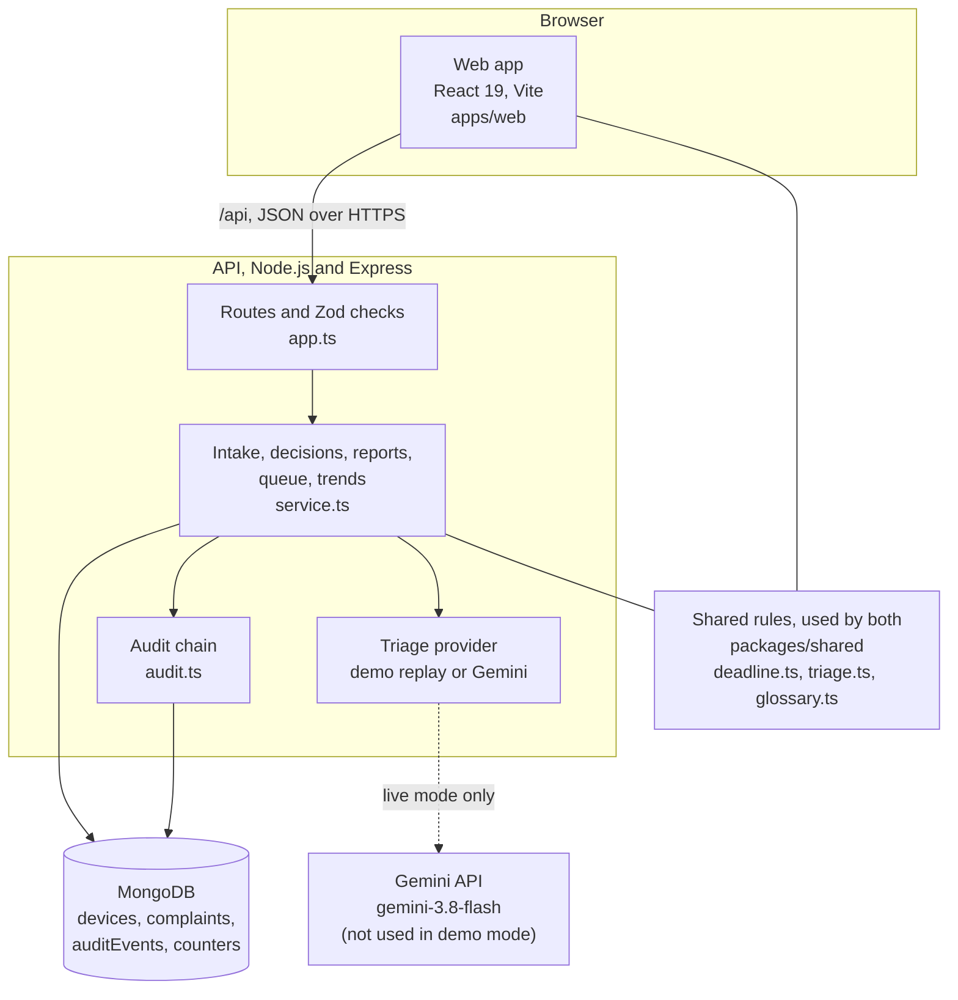
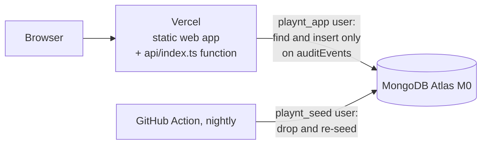

# Playnt, explained

This is a plain-language guide to what Playnt is, why it exists and how it is built. You do not need a background in healthcare or software to follow it. Technical terms are explained the first time they appear, and every term is in the [glossary](#glossary) at the end. The rules themselves, with a source for each, are in the [README](../README.md#deadline-rules-and-sources) and the [research notes](phase-1-research.md).

## In one sentence

Playnt is a simulated tool for a medical device manufacturer that sorts incoming complaints, with a language model suggesting which ones might be serious incidents and a person deciding, and that counts the legal reporting deadline to the exact day.

## In one paragraph

When something goes wrong with a medical device on the market, such as an infusion pump or a hospital bed, the people who use it complain to the company that made it. Under the EU Medical Device Regulation (MDR), the manufacturer must decide quickly whether a complaint could be a serious incident, and if so, report it to the authorities within 2, 10 or 15 days, depending on how bad it is. The judgement is hard and the date arithmetic is easy to get wrong. Playnt lets a language model (an AI system that reads and writes text) draft that first judgement, shows the exact words it relied on, and keeps the decision with a quality engineer, who confirms it or corrects it with a written reason. The deadline is computed from rules with sources, never by the model, and every step is written to an audit trail that shows if anyone tampered with it. Everything is synthetic: the manufacturer, Orrowell Medical GmbH, its five devices and all complaints are invented. It matters because it shows how a regulated decision can use a model without handing the decision to it, and how to prove afterwards who decided what, when and why.

## The real-world problem

### A short story

A paediatric nurse calls Orrowell Medical on Tuesday 20 October 2026. (The nurse and the patient are fictional, like everything in Playnt.) An IV-220 infusion pump kept running for about 15 minutes after she pressed stop. A child received an extra 8 mL of potassium chloride and needed cardiac monitoring overnight. The pump is out of service.

The person who takes the call writes it down. Now three questions come up, and each one has a legal answer:

1. **Is this a complaint?** Yes. It says the pump did not work as it should.
2. **Is it a possible serious incident?** Yes. A child needed medical care to prevent a life-threatening heart rhythm. But is that "harm that already happened", or "a near miss that might have led to harm"? The answer changes the deadline.
3. **By when must the report reach the authority?** If it counts as a serious deterioration of health that the manufacturer had not foreseen, 10 days. If it is a near miss, 15 days. Counted from which day, ending at what time, and what if a public holiday falls in between? (Monday 26 October is Austria's National Day.)

In Playnt's seeded story, the language model calls this a near miss with 15 days. The quality engineer corrects it to an unforeseen serious deterioration with 10 days, and has to write down why. The deadline moves from Wednesday 4 November to Friday 30 October.

### What goes wrong

- **The judgement is subtle.** The legal definitions use phrases like "might have led" and "unanticipated". Applying them to a short, messy phone note takes training, and two trained people can disagree.
- **The clock starts early.** The period runs from the day anyone at the manufacturer first hears about the event, not from when the quality team reads it. Days lost in an inbox count.
- **The date arithmetic has traps.** Days are calendar days, but a deadline that lands on a weekend or holiday moves, and very short periods must contain at least two working days. Those rules are in a 1971 EU regulation, not in the MDR.
- **A model can be confidently wrong.** If software trusts a model's answer, a wrong "15 days" becomes a late report. If it ignores the model, the time saved is lost.
- **Afterwards, someone will ask.** An auditor or authority may want to see who decided, when, and on what basis. A record that can be quietly edited is not proof.

Playnt addresses all five: the model only suggests and must quote the complaint word for word, a person confirms or corrects with a reason, the deadline comes from one tested function that names its sources, and every step goes into a hash-linked audit trail the database user cannot change.

## The healthcare background you need

**Medical device.** Any instrument, apparatus, software or material that a manufacturer intends for a medical purpose, from a plaster to a pacemaker. Devices sold in the EU must meet the MDR, Regulation (EU) 2017/745. They are grouped into risk classes I, IIa, IIb and III. Playnt's five fictional devices are an infusion pump (class IIb), a pulse oximeter (IIa), an electric care bed (I), a wound dressing (IIa) and a nebuliser (IIa) (`eval/devices.json`).

**Complaint.** Any written, electronic or spoken message that says a device has a problem with its identity, quality, durability, reliability, usability, safety or performance. The definition comes from the quality management standard ISO 13485:2016, as quoted in the official MDR guidance MDCG 2023-3 Rev.2. "The pump kept running after stop" is a complaint. "Could you send me the manual in German?" is not: it alleges no problem. Handling complaints is a required process in ISO 13485:2016 (clause 8.2.2, "Complaint handling"); Playnt cites that clause by number and title only, because the standard's text is paywalled.

**Incident.** Any malfunction or worsening of a device's performance, including a use error caused by its design, inadequate instructions and any undesirable side-effect (MDR Article 2(64)). Most complaints describe incidents.

**Serious incident.** An incident that directly or indirectly led, might have led or might lead to a death, a temporary or permanent serious deterioration of someone's health, or a serious public health threat (MDR Article 2(65)). The guidance says to judge "might have led" by asking: if this happened again, could it end in one of those outcomes? (MDCG 2023-3 Rev.2, Q2.) A causal link with the device only has to be reasonably possible, not proven.

**Serious deterioration of health.** The guidance lists examples: a life-threatening illness or injury, permanent damage to a body structure or function, being admitted to hospital or staying longer, and medical or surgical treatment to prevent any of these (MDCG 2023-3 Rev.2, Q2). Overnight heart monitoring to catch a dangerous rhythm after an overdose is treatment to prevent a life-threatening injury.

**Serious public health threat.** An event that could mean imminent risk of death, serious deterioration or serious illness, and may need prompt action, for example many people at risk at once (MDR Article 2(66)).

**Unanticipated.** Before a device goes on the market, the manufacturer writes a risk assessment: a list of the ways it could cause harm and what was done about each. A serious deterioration is "unanticipated" if the condition that caused it was not considered in that assessment (MDCG 2023-3 Rev.2, Q12). Think of a car maker that tested for brake fade on long descents: brake fade is anticipated, a brake pedal that falls off is not. In Playnt each fictional device has a short list of anticipated harms (its "risk file"), and the model and the labels judge "unanticipated" only against that list. The IV-220's list names over-infusion from free-flow when the cassette is loaded wrongly and under-infusion from a late occlusion alarm. A pump that keeps running after stop is not on it.

**Vigilance.** The system of reporting serious incidents to the national authorities (competent authorities) and following them up, so that problems with a device are caught and fixed across the EU. The manufacturer's report is called a Manufacturer Incident Report (MIR). Playnt records the date a report was submitted; it does not create or send the report.

**The three time limits.** MDR Article 87 says to report a serious incident immediately, and at the latest:

| Situation | Latest | Source |
|---|---|---|
| Serious public health threat | 2 days after awareness | MDR Art. 87(4) |
| Death, or an unanticipated serious deterioration of health | 10 days | MDR Art. 87(5) |
| Any other serious incident (including anticipated serious deterioration and "might have led") | 15 days | MDR Art. 87(3) |

The limit is the latest date, not the target: the duty is "immediately". If the manufacturer is not sure whether an incident must be reported, it reports within the limit anyway (Art. 87(7)).

**How the clock is counted.** Four rules, each with its own source, all implemented in `packages/shared/src/deadline.ts`:

1. **Awareness date.** The day the first employee or representative of the manufacturer receives the information (MDCG 2023-3 Rev.2, Q14 and Q15). It is day 0. If a sales rep heard about it on Monday and told the quality team on Thursday, Monday is day 0.
2. **Calendar days.** Every day counts, weekends included. The period starts the day after the awareness date and ends at the end of day 2, 10 or 15 (MDCG 2023-3 Rev.2, Q14, and Regulation (EEC, Euratom) No 1182/71, Article 3(1) and 3(2)(b)). Playnt ends a deadline at 23:59 Vienna time, where the fictional manufacturer sits.
3. **Weekends and public holidays.** If the last day is a Saturday, Sunday or public holiday, the period ends on the next working day (Regulation 1182/71 Art. 3(4)). Public holidays are those of the Member State where the action is taken (Art. 2(1)). Playnt uses the 13 Austrian public holidays from the Arbeitsruhegesetz, section 7(2), for 2026 and 2027, such as National Day on 26 October and the holidays that follow Easter. Outside those two years it refuses to compute a deadline rather than guess.
4. **The two-working-day rule.** Any period of two days or more must contain at least two working days (Regulation 1182/71 Art. 3(5)). This matters for the 2-day limit. If awareness is on Friday 23 October 2026, day 2 is Sunday 25 October, Monday 26 is National Day, and Tuesday 27 is the only working day so far, so the deadline is Wednesday 28 October.

A worked example from the story: awareness on Tuesday 20 October, 10-day limit. Day 10 is Friday 30 October, a working day, so the report is due by Friday 30 October at 23:59. National Day falls inside the period, which does not matter; only the last day moves. With 15 days it would have been Wednesday 4 November.

**Post-market surveillance and trend reporting.** After a device is on the market, the manufacturer must keep watching how it performs, with a written plan (MDR Articles 83 and 84). Part of that is trend reporting under Article 88: the manufacturer reports any statistically significant increase in how often, or how badly, non-serious incidents or expected side-effects happen. The method and the observation period come from the manufacturer's own plan. Playnt's trends page counts decided complaints per device, month and problem, and says plainly that counts are not a trend report: a simulation cannot honestly supply the method.

**Why a person decides.** The law puts the duty on the manufacturer, and the guidance asks for judgement ("cannot reasonably be excluded", "if it happened again"). A model can read quickly and draft a consistent first answer, but it can be wrong in either direction, and Playnt's own seeded story shows one such miss. So a qualified person confirms or corrects every suggestion, a correction is not saved without a reason of at least 10 characters, and the record says which was the model's suggestion and which was the human decision. Until a person decides, the deadline on screen is labelled "suggested".

## What it does, step by step

Here is one journey through the live demo at [playnt.vercel.app](https://playnt.vercel.app), as you see it and as the data moves underneath. The demo clock is fixed at Sunday 25 October 2026, 10:00 Vienna time (`PLAYNT_NOW` default in `apps/api/src/config.ts`), so every visitor sees the same deadlines.

1. **You open Playnt.** A strip says "Synthetic data. Not a validated quality management system." The sidebar says you are signed in as "Quality engineer (demo)" and that the demo replays recorded responses from `gemini-3.8-flash`. The browser asks `GET /api/health` and `GET /api/complaints?status=action`.
2. **You read the queue.** It opens on "Needs action": complaints waiting for a decision, and possible serious incidents whose report has not been recorded. Complaints with no usable model answer come first, because their risk is unknown, then open deadlines, nearest first. The top deadline is PLT-2026-0030, a death after a pump ran dry without an alarm: 10 days from Thursday 15 October would be Sunday 25 October, Monday 26 is National Day, so it is due Tuesday 27 October, "2 d 13 h left". Possible serious incidents carry a red left rule and a written flag with an icon, never colour alone. `J` and `K` move through the list, `Enter` opens a complaint, `?` lists the shortcuts.
3. **You log a new complaint.** On "New complaint" you pick the IV-220 and one of the sample texts: an occlusion alarm went off twice in the night with no occlusion, and the patient was fine. You give the reporter's role, the channel and the awareness date, 25 October. The browser sends `POST /api/complaints`. The API checks every field with Zod (a validation library) and refuses unknown fields. It numbers the complaint PLT-2026-0039.
4. **The model suggests.** The API builds a prompt from the complaint text and the device's risk file, never the reporter's details. In demo mode it looks up a recorded answer by a SHA-256 hash of the prompt version and the exact request; with a key it would call Gemini. The answer must be strict JSON (structured text) in a fixed shape and must quote the complaint word for word. This one parses: "Might have led to a serious outcome, 15 days". The API, not the model, works out the deadline: Monday 9 November, 23:59. In one database transaction it saves the complaint with the suggestion inside it, takes the next reference number and writes two audit events, "complaint logged" and "model suggestion stored": all of it is stored, or none of it.
5. **You read the suggestion.** The complaint screen shows the text as received, with the model's quote highlighted, the suggestion and its one-sentence rationale, and the deadline as a day-by-day calendar with weekends and holidays hatched. Each regulatory term, such as "serious incident" or "awareness date", opens its definition and source on hover, focus or tap.
6. **You correct it.** `R` opens the correction form. You set "complaint, not a possible serious incident" and write why: a nuisance alarm, infusion restarted within a minute, no path to serious harm described. The form will not save a reason shorter than 10 characters. The browser sends `POST /api/complaints/:id/decisions`. The API checks the correction is consistent (for example, "not serious" must have no time limit), appends the decision to the complaint's history only if nobody else decided in the meantime, removes the deadline, and writes a "triage corrected" audit event that includes the reason, in the same transaction. Focus moves to the next complaint waiting for a decision.
7. **You open the seeded story, PLT-2026-0034.** The model said "might have led, 15 days"; the seeded engineer corrected it to "serious deterioration, unanticipated, 10 days" with a reason citing MDCG 2023-3 Q2 and the IV-220 risk file. The calendar shows day 0 on Tuesday 20 October, the weekend and National Day hatched, and the due date Friday 30 October.
8. **You confirm one.** On PLT-2026-0032 (a bed's side rail latch released; the carer caught the resident) the model suggests "might have led, 15 days". `C` confirms it; the deadline is now labelled decided.
9. **You record a report.** For a decided possible serious incident you can record the date the report was submitted (`POST /api/complaints/:id/report`). The clock stops, and the audit event says whether it was within the deadline. Playnt refuses a date before the awareness date, a date in the future or a second record.
10. **You check the audit trail.** The audit page lists recent events (`GET /api/audit`). "Check the chain" (`GET /api/audit/verify`) recomputes every event's hash and link and answers, for example, "All 117 events across 38 complaints link correctly", or names the complaint and sequence number where the chain breaks.
11. **You look at trends.** `GET /api/trends` runs one aggregation over decided triage only and shows complaints per device and month, and the problems behind them, with a note that undecided complaints are left out and that counts are not an Article 88 trend report.

Every night a scheduled GitHub Action drops the demo database and loads the seeded story again, so your changes are gone the next day.

## How it is built

In the hosted demo the same Express app runs as one Vercel Function in Frankfurt (`fra1`), and the data lives on a MongoDB Atlas M0 cluster:

### The parts

| Part | What it is | Why it exists | Talks to |
|---|---|---|---|
| **Web app** (`apps/web`) | The screens: queue, new complaint, complaint, trends, audit, sources. | So a quality engineer can read, decide and move on with the keyboard. | Only the API on its own origin (`apps/web/src/api.ts`). |
| **Shared package** (`packages/shared`) | The deadline engine, the triage schemas, the strict parser for model output, the glossary and the Wilson interval. | One copy of every rule, so the browser and the server can never disagree. | Imported by the API and the web app. |
| **Deadline engine** (`packages/shared/src/deadline.ts`) | `computeDeadline()` turns an awareness date and a limit into a due date, a due instant and a day-by-day calendar with reasons. | The legal arithmetic, in one tested place. | Nothing; it is a pure function. |
| **Triage schema and parser** (`packages/shared/src/triage.ts`) | The fixed shape of a suggestion, the map from outcome to 2, 10 or 15 days, and `parseModelOutput()`. | To accept only exactly right model output, and never repair it. | Used by the API and the evaluation script. |
| **API** (`apps/api/src/app.ts`, `service.ts`) | An Express server with 12 routes: intake, decisions, report, retry, lists, trends, audit and health. | The only place that writes data, so every write is checked and audited. | MongoDB and the triage provider. |
| **Triage providers** (`apps/api/src/triage/`) | One interface, two implementations: `DemoProvider` replays recordings, `GeminiProvider` calls the Gemini REST API. | The demo and CI need no key and no network; live mode uses the real model. Both return raw text, held to the same parser. | The recordings file, or Gemini. |
| **Prompt** (`apps/api/src/triage/prompt.ts`) | The instructions and definitions the model gets, version `triage-v1`. | Recordings and evaluation results are keyed by this version, so a changed prompt never replays a stale answer. | The providers. |
| **Audit chain** (`apps/api/src/audit.ts`) | `appendAudit()` adds an event with a sequence number and the hash of the previous one; `verifyChains()` checks them all. | Tamper evidence, without trusting the application. | The `auditEvents` collection. |
| **Database setup** (`apps/api/src/db.ts`) | Collection validators, indexes and the `playntApp` role. | The database refuses what the API should never write, and the app user cannot change the audit trail. | MongoDB. |
| **Seed** (`apps/api/src/seed.ts`, `apps/api/data/seed.json`) | 38 synthetic complaints: 28 decided history items from February to September 2026 and 10 recent ones. | A story that shows every state, through the same code paths a visitor uses. | The service functions. |
| **Evaluation** (`eval/`, `apps/api/scripts/eval.ts`) | A frozen set of 40 labelled complaints, a separate set of 8 for prompt work, and the script that scores the model. | To measure the model honestly, once, before trusting it. | Gemini, with a key. |
| **Serverless entry** (`api/index.ts`, `apps/api/src/handler.ts`) | Builds the Express app and the MongoDB client once per function instance and reuses them. | So the hosted demo is the same API, not a copy. | Vercel and Atlas. |

### MongoDB, in plain words

A **relational database**, such as PostgreSQL, stores data in tables with fixed columns, like a set of spreadsheets that point at each other. A complaint would be one row in a `complaints` table, each model suggestion a row in a `suggestions` table, each decision a row in a `decisions` table, and the screen would join them back together with a query. The database enforces the columns and the links between tables.

A **document database**, such as MongoDB, stores each record as one document: a nested, JSON-like structure that can hold lists and sub-records inside it. A complaint can carry its whole history inside itself.

An analogy: a relational database is a filing cabinet with one drawer per kind of form, and an index card telling you which forms belong together. A document database is a case folder per complaint, with every form about that complaint clipped inside. The folder is quicker when you always look at one case at a time. The drawers are better when you often compare the same form across thousands of cases, or when one form belongs to many cases.

Neither is "schema-free" in Playnt. MongoDB checks every device, complaint and audit event against a JSON Schema validator (a written description of the allowed shape), and the API checks every request body and query with Zod before it gets that far. Only `counters`, which holds one number per year, has no validator.

### Why each collection looks the way it does

- **`complaints` embeds its triage history.** Each model suggestion and each human decision is an element of the `triageHistory` list inside the complaint. They belong to exactly one complaint, are never shared, and the complaint screen always shows them together, so one read serves the whole screen. Next to the history the complaint keeps a `current` summary (complaint or not, possible serious incident or not, problem, limit, suggested or decided) and the `deadline`, copied from the latest entry. That copy is a deliberate duplication, called denormalisation: it lets the queue filter and sort with an index instead of digging through every history list. The copy is always recomputed from the history by one function, `derive()` in `service.ts`.
- **`devices` is referenced, not embedded.** A device's risk file is shared by many complaints and changes on its own schedule, so complaints store the device's id and the API looks it up. The prompt reads the risk file at the moment of triage.
- **`auditEvents` is its own collection, append-only.** One event per intake, model suggestion, rejected model output, decision and report: six event types. Each carries a per-complaint sequence number (1, 2, 3...) and the SHA-256 hash of the event before it, so the events form a chain, like pages in a bound book with numbered pages. The complaint itself records the number and hash of its last event (`auditHead`), like a note on the cover saying how many pages the book has, so a missing last page shows too. It is separate from `complaints` because complaints change (a decision updates them) and the audit trail must not, and because a separate collection can have its own, stricter permissions.
- **`counters`** holds one number per year, so complaint references (`PLT-2026-0034`) are issued without gaps or duplicates, using one atomic "add one and tell me the new value" operation.
- **Indexes follow the screens.** `{ status: 1, "deadline.dueAt": 1 }` for the queue, `{ deviceId: 1, awarenessDate: -1 }` for trends, `{ complaintId: 1, seq: 1 }` unique for the audit chain, plus unique complaint and device references (`setupCollections()` in `db.ts`).

## The technology stack

| Technology | What it does here | Why this one |
|---|---|---|
| TypeScript 6.0 | The language for all three packages. | One language and one set of types from the deadline rule to the screen. |
| Node.js 22 | Runs the API and the scripts. | Required in `package.json` (`engines`); the same language as the browser, so the rules are shared. |
| npm workspaces | Three packages in one repository: `packages/shared`, `apps/api`, `apps/web`. | Lets the API and the web app import the same rules. |
| Express 5.3 | The API's HTTP server. | Not recorded in the repo: not confirmed. |
| MongoDB 8.0 (Docker), MongoDB Node.js driver 7.7 | Stores devices, complaints, audit events and counters. | `docs/phase-1-research.md` section 3: the complaint and its history are read together, so they are modelled as one document; validators, indexes and roles carry the guarantees. |
| Zod 4.6 | Checks every request body and query, and every model output, against a schema. | Strict objects reject unknown keys, and the same schemas give the TypeScript types. |
| Gemini API, `gemini-3.8-flash`, called over plain HTTPS | Drafts the triage suggestion. | `docs/phase-1-research.md` section 7: the same model as the author's medrag-eval project. No SDK; one `fetch` call with a response schema. |
| React 19.3, React Router 8.5 | The web app and its six pages. | Not recorded in the repo: not confirmed. |
| Vite 8.3 | Builds and serves the web app. | Not recorded in the repo: not confirmed. |
| Atkinson Hyperlegible Next | The typeface, self-hosted through Fontsource. | Designed for legibility; self-hosted, so no request goes to a font service. |
| Vitest 5 | Unit and API tests. | One runner for the shared package and the API. |
| mongodb-memory-server 11, supertest 7 | Starts a real MongoDB in memory, as a one-member replica set, for tests and the local demo; sends HTTP requests to the app without a network port. | Tests run against real MongoDB behaviour (transactions, validators, roles, unique indexes) without Docker. |
| Playwright 1.64 with @axe-core/playwright 4.14 | Browser tests in Chromium, in light and dark mode, with automated accessibility checks. | Also watches every request the page makes. |
| ESLint 10 with typescript-eslint | Code checks. | Run in CI. |
| tsx, concurrently | Run TypeScript directly for scripts; start the API and the web app together. | No separate build step for development. |
| Docker Compose | Runs MongoDB 8.0 locally on `127.0.0.1:27017` as a one-member replica set. | For working against a real database with users, passwords and transactions. |
| GitHub Actions | CI on every push and pull request, and the nightly re-seed. | Free for a public repository. |
| Vercel | Hosts the web app and the API as one function in Frankfurt. | Same API code as local; region close to the fictional Vienna manufacturer. |
| MongoDB Atlas M0 | The hosted demo's database. | The free tier supports custom database roles, so the hosted demo keeps the least-privilege guarantee (README, "Hosted demo"). |

## The hard parts and how they were solved

### 1. A deadline that is right to the day

**Problem.** The MDR gives 2, 10 or 15 days but does not say how to count them. Counting from the wrong day, ending at midnight UTC instead of local time, or forgetting a holiday gives a date that is a day early (wasted urgency) or a day late (a late report).

**Solution.** One pure function, `computeDeadline()`, applies the four counting rules in a fixed order and returns not only the due date but the whole calendar with a reason for every rest day and a plain-language explanation. Day 0 is the awareness date. The legal last day is awareness plus the limit. If it is a rest day, the end moves forward day by day. Then, for periods of two days or more, it keeps moving until the period holds two working days and ends on a working day. The end instant is 23:59:59 in Vienna, computed with the time zone database so it is correct on both sides of the change to and from summer time. The Austrian holidays are computed: fixed dates, plus Easter Monday, Ascension Day, Whit Monday and Corpus Christi from an Easter algorithm, and checked against a table written out by hand. Outside 2026 and 2027 the function throws `DeadlineRangeError` and the complaint simply has no computed deadline, rather than a guessed one.

**Where.** `packages/shared/src/deadline.ts`. Tests in `packages/shared/src/deadline.test.ts`: "moves past a weekend followed by a public holiday" (15 October plus 10 is Sunday 25, then National Day, so Tuesday 27), "keeps two working days in a 2-day period (Regulation 1182/71 Art. 3(5))" (Friday 23 October plus 2 is Wednesday 28), "counts the same day numbers as the MDCG 2023-3 Q14 example", "ends at 23:59:59 Vienna time in winter and summer", and "is still open one second before the deadline and overdue one second after". The API test "sets the 2-day deadline across a weekend and the Austrian National Day to Wed 28 Oct 23:59:59 Vienna" checks the same through HTTP.

### 2. Using a model without trusting it

**Problem.** A language model can return prose instead of JSON, wrap JSON in formatting, invent a field, give a 15-day limit for a death, or "quote" a sentence that is not in the complaint. If the software repairs or guesses around these, a wrong answer looks like a right one.

**Solution.** Four layers. First, the model only suggests an outcome category; the server maps the category to 2, 10 or 15 days with one table (`OUTCOME_LIMIT` in `triage.ts`), and a suggestion whose limit disagrees is rejected. Second, `parseModelOutput()` accepts only exact JSON in a strict schema: unknown keys, missing keys and wrong types are refused, nothing is coerced. Third, consistency rules: something that is not a complaint cannot be a serious incident, and "no serious outcome" must go with "not a possible serious incident". Fourth, the evidence quote must be an exact passage of the complaint, character for character, which also lets the screen highlight it. Anything that fails is stored raw next to the error, the complaint is marked "needs manual triage", and the person can triage it by hand or ask the model again. It is never repaired.

**Where.** `parseModelOutput()` and `triageConsistency()` in `packages/shared/src/triage.ts`, `suggest()` in `apps/api/src/service.ts`. Tests: "rejects %s without repairing it" in `packages/shared/src/triage.test.ts` runs ten bad outputs, including "JSON in a code fence", "an extra field", "a time limit that does not match the outcome" and "a paraphrased quote"; "stores %s as needs manual triage with the raw output kept verbatim" in `apps/api/test/api.test.ts`.

### 3. An audit trail the application cannot rewrite

**Problem.** An audit trail is only worth something if editing or deleting an entry would be noticed, and if the software that writes it cannot quietly change it.

**Solution.** Two independent guards. The first is a hash chain: each event's SHA-256 hash covers its content and the previous event's hash, computed over a canonical form with sorted keys so the hash does not depend on the order fields were written. Changing an event breaks its own hash; deleting one breaks the next event's link and the sequence. Deleting the last event would leave a shorter chain that still links, so each complaint also stores the sequence number and hash of its last event (`auditHead`), written in the same transaction as the event. `verifyChains()` walks every complaint's chain, checks that it ends exactly where the complaint says, and names each break, including a complaint whose whole chain is gone. The second guard is in the database itself: the application connects as a user whose custom role `playntApp` allows only `find` and `insert` on `auditEvents`, so MongoDB refuses an update, replace, delete or drop from the application with an "unauthorized" error. The API also has no route that changes an event. A unique index on complaint and sequence number stops two writers from both adding event number 4. On the hosted demo the same role exists in Atlas, with a separate user only for the nightly reset.

**Where.** `apps/api/src/audit.ts` (`hashEvent()`, `appendAudit()`, `verifyChains()`), `setupAppRole()` in `apps/api/src/db.ts`. Tests: "detects an event edited directly in the database", "detects a deleted event as a broken link", "detects a deleted last event, which still leaves a chain that links" and "detects a complaint whose whole chain was deleted" in `apps/api/test/api.test.ts`; "is refused by MongoDB when it tries to %s audit events" (update, replace, delete, drop) in `apps/api/test/audit-role.test.ts`, run against a MongoDB with authentication switched on.

### 4. Two people deciding at once, and writes that stop halfway

**Problem.** If two quality engineers open the same complaint and both press confirm, or one confirms while the other corrects, a naive update would record both, or let the second silently overwrite the first. And every action is several writes: the complaint, then its audit events. If the server stopped between them, a complaint could exist without the record of how it got there.

**Solution.** Optimistic concurrency. The decision is written with a condition: "update this complaint only if its history still has exactly the number of entries I read". If someone else added an entry in the meantime, the update matches nothing and the API answers 409, "This complaint changed while you were deciding. Reload and try again." The same pattern protects a retry after a model failure and a report record. Confirming twice, or confirming a rejected suggestion, is refused for the same reason. Each action and its audit events are then written in one MongoDB transaction (`inTransaction()` in `db.ts`): at intake the complaint, its reference number and its first two audit events; for a decision, a retry or a report, the change to the complaint and its event. Either all of it is stored or none of it is, and a failed intake does not even use up a reference number. The model is asked before the transaction starts, so a slow model never holds it open. Transactions need a replica set, a group of database servers that copy each other; MongoDB Atlas always is one, and the tests, the local demo and `docker-compose.yml` each run a one-member set. These two gaps were found while writing this document and fixed the same day, with tests.

**Where.** `decide()`, `retryTriage()` and `recordReport()` in `apps/api/src/service.ts` (the `$size` condition), `logComplaint()` and `inTransaction()`. Tests in `apps/api/test/api.test.ts`: "refuses to confirm twice or to confirm a rejected suggestion", "writes nothing at intake when an audit event cannot be stored: no complaint, no event, no used reference" and "rolls back a decision when its audit event cannot be stored", which make the database refuse an audit write on purpose.

### 5. A demo that never calls the model

**Problem.** A public demo cannot hold a model key, and every visitor must see the same answers. But a demo with invented answers would show behaviour the real model never had.

**Solution.** The model's real answers were recorded once, with a key, for 37 of the 38 seeded complaints and the three intake samples: 40 recordings from `gemini-3.8-flash` on 25 October 2026. Each is stored under a SHA-256 hash of the prompt version and the exact system and user text, so a changed prompt or device description never replays a stale answer. In demo mode `DemoProvider` only looks answers up. Text without a recording goes to manual triage, so the demo never invents an answer. One seeded complaint, PLT-2026-0037, is deliberately left unrecorded to show that state. The clock is fixed at 25 October 2026, 10:00 Vienna, so the seeded deadlines read the same every day, and the database is reset nightly.

**Where.** `apps/api/src/triage/demo.ts`, `apps/api/recordings/triage-v1.json`, `apps/api/scripts/record.ts`, `apps/api/src/config.ts`, `.github/workflows/reseed.yml`. Tests: "seeds, serves and triages a new complaint without any request leaving the machine" and "would catch a real provider: the watch is not vacuous" in `apps/api/test/demo-network.test.ts`; "no request leaves localhost in demo mode" in `apps/web/e2e/no-network.spec.ts`.

### 6. Measuring the model honestly

**Problem.** It is easy to make a model look good by adjusting the prompt until it passes the test set, or by reporting one number without saying how uncertain it is.

**Solution.** 40 synthetic complaints were written and labelled before any prompt existed, each with a one-line basis; the 12 ambiguous labels were reviewed a second time; then the set was frozen with SHA-256 hashes of the labels and the device file in `eval/FROZEN.md`. The evaluation script refuses to run if either hash changed. The prompt was developed on a separate set of 8 complaints. The model ran once, at temperature 0 (the setting that makes its answers as repeatable as possible), and the prompt was not changed afterwards. Results are reported for all 40, the 28 clear and the 12 ambiguous items, each with a 95% Wilson interval, a way of stating the range the true rate plausibly lies in that still works when every case succeeded. Invalid output would count as "not flagged", which can only lower recall.

**Where.** `eval/labelled-complaints.json`, `eval/dev-complaints.json`, `eval/FROZEN.md`, `apps/api/scripts/eval.ts`, `wilson()` in `packages/shared/src/stats.ts` (test: "matches published 95% intervals"), results in `eval/results/eval-gemini-3.8-flash-triage-v1-2026-10-25.json`.

## How we know it works

Counts below are from running every suite locally on 25 October 2026, after the transaction and audit-head fixes (commit `9c10d80`). All passed.

| Suite | Command | Tests | What it proves |
|---|---|---|---|
| Shared rules | `npm test -w packages/shared` | 29 | The holidays against a fixed table for 2026 and 2027; Easter; refusal outside those years; every counting rule at its edge, including the MDCG 2023-3 example, both time zones and one second either side of a deadline; ten kinds of bad model output, each refused; a correction needs a reason; Wilson intervals against known values. |
| API | `npm test -w apps/api` | 44 | On a real MongoDB in memory, run as a replica set: every intake validation error, unknown fields and future awareness dates refused; only complaint text and risk file sent to the model; model output stored with model, prompt version and raw text; rejected output and provider failures going to manual triage; confirm, correct, retry and report; the queue order; the audit chain catching an edit, a deletion, a deleted last event and a deleted chain; intake and decisions rolled back when an audit write fails; validators refusing bad documents written around the API; the least-privilege user refused on update, replace, delete and drop; trends; the serverless handler; demo mode with no request leaving the machine. |
| Browser | `npm run test:e2e` | 28 | 14 scenarios, each in light mode at 1440 x 900 and dark mode at 1280 x 800: the queue, filters and empty state, `J`, `K`, `Enter`, `Esc`, `C` and `?`; the seeded correction with its reason, deadline and audit trail; tooltips on focus; a correction refused without a reason; manual triage with retry; a not-found page; axe accessibility checks against the WCAG 2.0 to 2.2 A and AA rules on every page, the correction form and the shortcuts dialog; no request leaving localhost. |

That is 101 tests: 29 unit, 44 API and 28 browser.

**Continuous integration** (`.github/workflows/ci.yml`) runs one job on every push to `main` and every pull request: install, build the shared package, typecheck, lint, the 73 unit and API tests on mongodb-memory-server, then the 28 browser tests in demo mode. It needs no secrets.

**The model evaluation**, run once on 25 October 2026 with `gemini-3.8-flash`, temperature 0, prompt `triage-v1`, over the frozen set of 40:

| | All 40 | 28 clear | 12 ambiguous |
|---|---|---|---|
| Serious incident flag, precision | 0.913 (21 of 23) | 0.933 (14 of 15) | 0.875 (7 of 8) |
| 95% Wilson interval | 0.732 to 0.976 | 0.702 to 0.988 | 0.529 to 0.978 |
| Serious incident flag, recall | 1.000 (21 of 21) | 1.000 (14 of 14) | 1.000 (7 of 7) |
| 95% Wilson interval | 0.845 to 1.000 | 0.785 to 1.000 | 0.646 to 1.000 |
| Time limit agreement, where both flagged | 21 of 21 | 14 of 14 | 7 of 7 |
| Complaint or not, agreement | 40 of 40 | 28 of 28 | 12 of 12 |
| Invalid model output | 0 | 0 | 0 |

In plain words: precision is "of the complaints the model flagged as possible serious incidents, how many the labels agree are"; recall is "of the labelled possible serious incidents, how many the model flagged". The model missed none of the 21 labelled serious incidents and gave the labelled limit every time, including both 2-day public health threats. Its two errors both flag a non-serious fault as "might have led": a nebuliser that did not switch on before use (EV-28) and an oximeter with visibly jumping readings (EV-30), where the label itself notes that a reasonable reviewer could flag it.

How far these numbers go: 40 items is small. One more false positive would move precision by about four points, and on this set recall is only shown to be above 0.85. The labels are one person's reading, by someone with quality and regulatory training, not a vigilance specialist. The 38 demo complaints are a separate set and do not count towards these numbers. In the demo, the seeded engineer decides 34 of them: 26 confirmations and 8 corrections. Seven corrections go the same way as the evaluation errors; one, PLT-2026-0034, goes the other way.

**The hosted demo** was checked end to end on 25 October 2026 after deployment: queue, a complaint, confirm, correct, trends and the audit chain check ("All 117 events across 38 complaints link correctly"). A fresh seed holds 38 complaints and 115 audit events with no broken links.

## What is deliberately simplified or left out

| Simplification | Why |
|---|---|
| One simulated quality engineer, no sign-in. Decisions record a role, "Quality engineer (demo)", not a person. | The point is the triage and the record. A real system needs named users and authentication, so "who decided" names a person. |
| Playnt records the date a report was submitted. It does not produce the Manufacturer Incident Report form, submit to EUDAMED (the EU's device database) or track follow-up and final reports. | Each of those is a project of its own. |
| Trends are counts, not an Article 88 trend report. | Significance needs a method and observation period from the manufacturer's post-market surveillance plan, which a simulation cannot honestly supply. |
| Austrian public holidays only, for 2026 and 2027. | Holidays depend on the Member State (Regulation 1182/71 Art. 2(1)). The UI says so next to each deadline. |
| No "reportability awareness date" for when later information makes an incident reportable (MDCG 2023-3 Q15). | First item on the cut list in the plan; listed as a next step. |
| Device problems are free text, not coded with IMDRF Annex A terms. | The licence terms of the code tables could not be verified, and the IMDRF website terms restrict commercial reuse, which conflicts with the MIT licence (research notes, section 1). |
| No field safety corrective actions, periodic safety update reports (PSUR), IVDR, attachments, email intake, other languages or other manufacturers. | Out of scope for the first version. |
| ISO 13485:2016 is cited by clause number and title only. | The standard is paywalled; the complaint definition comes from the public MDCG quote. |
| The demo clock is frozen and the data resets nightly. | So every visitor sees the same deadlines and the same story. |
| The evaluation has one labeller. | Listed as a next step: a second labeller and agreement between labellers. |

Also worth knowing:

- Logging a complaint calls the model inside the same web request. With a live model the request waits for the answer (up to five tries with backoff, 60 seconds each). That is fine for one user and wrong at volume. The next step is a queue (for example BullMQ on Redis): intake saves the complaint at once, and workers call the model within its quota, with retries and manual triage after the last attempt.
- Two weak spots were found while writing this document and fixed, with tests: intake used to write the complaint and its audit events one after the other, not in one transaction, and deleting the last event of a chain used to go unnoticed. See hard parts 3 and 4.
- Someone with full administrator rights on the database could still change both an event and the complaint's record of it consistently. Protecting against that needs the chain heads copied somewhere outside the database, or signed; not built.

## Glossary

**Aggregation pipeline.** A MongoDB query written as a list of steps (filter, group, look up, sort) that the database runs in order. Playnt's trends page is one pipeline.

**Anticipated harm.** A harm the manufacturer listed in its risk assessment before the device went on the market. The opposite of unanticipated.

**API.** The part of a program that other programs talk to. Here, the Express server that the web app calls at `/api/...`.

**Audit head.** In Playnt, the sequence number and hash of a complaint's last audit event, stored on the complaint, so a missing last event is noticed.

**Audit trail.** A record of who did what and when, kept so it can be checked later.

**Awareness date.** The day the first employee or representative of the manufacturer receives the information. Day 0 of the reporting period.

**axe.** An automated checker that tests a web page against accessibility rules.

**Calendar days.** Counting every day, including weekends and holidays, with the end moved to the next working day if it falls on a rest day.

**CI (continuous integration).** Automated checks that run on every change to the code, here on GitHub Actions.

**Competent authority.** The national body in each EU country that receives serious incident reports, such as the BASG in Austria.

**Complaint.** A message that says a device has a problem with its identity, quality, durability, reliability, usability, safety or performance (ISO 13485:2016, as quoted in MDCG 2023-3).

**Correction.** In Playnt, a human decision that replaces the model's suggestion. It needs a reason.

**Demo mode.** Playnt's mode that replays recorded model answers, uses a fixed clock and never calls the network.

**Denormalisation.** Keeping a copy of some data next to where it is used, to make reading faster, at the cost of keeping the copy correct.

**Document database.** A database that stores each record as one nested, JSON-like document. MongoDB is one.

**Embedded and referenced.** In a document database, embedded data lives inside the parent document; referenced data lives in its own document and is pointed to by id.

**EUDAMED.** The European database on medical devices, which includes vigilance.

**Evidence quote.** The exact passage of the complaint that the model says supports its suggestion. Playnt rejects a quote that is not in the complaint.

**Express.** A widely used web server framework for Node.js.

**Gemini.** Google's family of language models; Playnt uses `gemini-3.8-flash`.

**Hash (SHA-256).** A fixed-length fingerprint of some data. Changing one character of the data changes the fingerprint completely.

**Hash chain.** A list of records where each one includes the hash of the one before, so changing or removing a record breaks the links after it.

**Incident.** Any malfunction or worsening of a device's performance, including use error from its design, poor instructions and undesirable side-effects (MDR Art. 2(64)).

**Index.** A sorted lookup structure that lets a database find and order records without reading all of them.

**IMDRF.** The International Medical Device Regulators Forum, which publishes coded terms for device problems.

**ISO 13485.** The international standard for quality management systems for medical devices.

**JSON.** A simple text format for structured data.

**JSON Schema validator.** A rule in MongoDB that describes the allowed shape of documents in a collection; documents that do not match are refused.

**Language model.** An AI system trained on large amounts of text that can read a prompt and write an answer.

**Least privilege.** Giving a user or program only the permissions it needs, and no more.

**Manual triage.** In Playnt, the state of a complaint with no usable model suggestion, which a person must triage by hand.

**MDCG 2023-3.** Official guidance from the EU's Medical Device Coordination Group on vigilance terms and concepts. Revision 2 is used. Guidance, not law.

**MDR.** The EU Medical Device Regulation, Regulation (EU) 2017/745.

**Manufacturer Incident Report (MIR).** The form a manufacturer uses to report a serious incident.

**MongoDB Atlas.** MongoDB's hosted database service. M0 is its free tier.

**Node.js.** A program that runs JavaScript outside the browser, used for servers.

**Optimistic concurrency.** Writing a change only if the data is still as you read it, and asking the user to reload otherwise.

**Post-market surveillance (PMS).** The manufacturer's ongoing monitoring of a device after it is on the market.

**Precision.** Of the cases flagged, the share that were right.

**Prompt.** The instructions and text given to a language model.

**Recall.** Of the cases that should have been flagged, the share that were.

**Recording.** A real model answer saved once and replayed in demo mode.

**Relational database.** A database that stores data in tables with fixed columns and links between them, such as PostgreSQL.

**Replica set.** A group of MongoDB servers that keep copies of the same data. Transactions need one; it can have a single member.

**Risk class.** The EU's grouping of devices by risk: I, IIa, IIb and III.

**Risk file.** The manufacturer's documented risk assessment for a device. In Playnt, a short list of anticipated harms and expected side-effects per device.

**Role (database).** A named set of permissions in MongoDB. Playnt's `playntApp` role allows only find and insert on the audit trail.

**Serious deterioration of health.** For example a life-threatening illness or injury, permanent impairment, hospitalisation, or treatment to prevent these (MDCG 2023-3 Q2).

**Serious incident.** An incident that led, might have led or might lead to death, serious deterioration of health or a serious public health threat (MDR Art. 2(65)).

**Serious public health threat.** An event that could mean imminent risk of death, serious deterioration or serious illness and may need prompt action (MDR Art. 2(66)). Reported within 2 days.

**Serverless function.** Code that a hosting service runs on demand for each request, without a server you manage. Playnt's API runs as one Vercel Function.

**Synthetic data.** Made-up data that looks real but belongs to no one.

**Temperature.** A model setting for how much randomness is in its answers; 0 makes them as repeatable as possible.

**Transaction.** A group of database writes that are stored together or not at all.

**Trend reporting.** Reporting a statistically significant increase in non-serious incidents or expected side-effects (MDR Art. 88).

**Triage.** Sorting incoming cases by how urgent and serious they are.

**Unanticipated.** Not considered in the manufacturer's risk assessment (MDCG 2023-3 Q12). Death or an unanticipated serious deterioration is reported within 10 days.

**Vigilance.** The EU system of reporting and following up serious incidents with medical devices.

**WCAG.** The Web Content Accessibility Guidelines, the international standard for accessible websites.

**Wilson interval.** A way to give the range a true rate plausibly lies in, given a small number of cases. It stays between 0 and 1 and still gives a useful lower bound when every case succeeded.

**Working day.** A day that is not a Saturday, Sunday or public holiday.

**Zod.** A TypeScript library that checks data against a schema and gives matching types.
